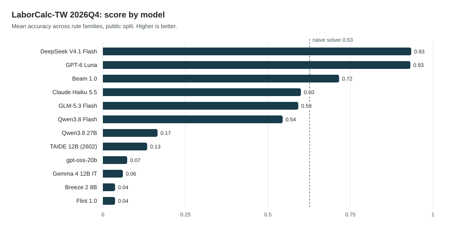
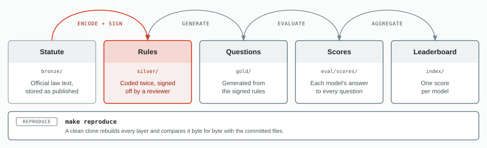

# LaborCalc-TW

LaborCalc-TW is a benchmark of Taiwan labor-law calculations. Each question asks a model to compute a single number, such as overtime pay or annual leave days, from a short scenario in Traditional Chinese. Code-based rules, rather than human labeling, determine the correct answers, and every question traces back to the statute it tests.

This repository holds release **2026Q4**: the rule code, the public question sets, the scores, and everything needed to rebuild them from the statute text.

- Website (results and an interactive calculator): https://taiwaneval.org/datasets/laborcalc-tw
- Dataset (questions and per-question results): https://huggingface.co/datasets/taiwaneval/LaborCalc-TW. For each model, it includes the parsed answer, score, and error attribution for every question. Raw model outputs are not published.
- License: code Apache-2.0; data CC BY 4.0 (see [Licenses](#licenses)).



## Reproduce

```bash
make reproduce
```

This command clones the current commit into a temporary directory, creates a fresh virtual environment from `requirements.txt` alone, rebuilds every layer from its committed inputs, and compares the result byte for byte against the committed files. Because raw evaluation logs contain model output text and are not published, it rebuilds the index from the score table in `eval/scores/<release>/`, which was extracted from those logs. Reproduction takes about one minute and requires Python 3.12, Node.js 22 (to run the JavaScript rule implementations), and git. If any layer differs, the command prints the layer, file, and first difference, then exits with status 1.

## What is in a release

| Family | Version | Public questions |
| --- | --- | --- |
| `annual_leave_days` | 0.1.3 | 200 |
| `overtime_pay` | 0.2.2 | 200 |

The 2026Q4 results cover 12 model targets. A target pairs a model with its serving setup (`model@quantization@hardware@mode`); for example, a 4-bit build on a local Mac is a different target from the same model served behind an API.



The work is organized in layers, and each layer is built only from the preceding one:

| Layer | Path | What it holds |
| --- | --- | --- |
| bronze | `bronze/<pcode>/` | The statute text from the national law database open data (via a public GitHub mirror), stored byte for byte alongside a provenance record of when and where it was fetched and its sha256. |
| silver | `silver/inventory/<pcode>/` | An inventory of every paragraph in the statute, a triage of which paragraphs can be turned into calculations, and human review decisions (`reviews/*.yaml`). |
| silver | `silver/families/<id>/` | A rule family: `spec.yaml` (the rule in prose, with its legal basis and scope), two independent implementations (`rule.py` and `rule.js`, cross-checked by `test_agreement.py`), question templates, the parameter sampler, and `hypotheses.py` (wrong rules that models are likely to apply). |
| gold | `gold/releases/<release>/public/` | Generated questions (`*.jsonl`) and a per-family manifest recording the sha256 of the spec, rule, templates, and sampler, the generator version, and the date the questions were generated for. |
| eval | `eval/tasks/rules_registry.py` | The [Inspect AI](https://inspect.aisi.org.uk/) task that runs a model on a question set and scores it. |
| eval | `eval/scores/<release>/` | The score table: one row per target and question (`items.jsonl`) with the parsed integer answer, whether it was correct, and error attribution, plus one record per evaluation run (`runs.json`). Contains no model output text. The index is computed from this table. |
| index | `index/<release>/` | Scores per target and family (`index.json`), per-question results (`items.csv`), and a data bundle for the website (`site-data/`). |

## How questions are made

1. A person reads the statute and writes the rule in `spec.yaml`, specifying which articles it encodes, the formula, deliberate exclusions, and rounding behavior.
2. Two separate code paths implement the rule independently in Python and JavaScript. A family is accepted only when both implementations agree on every golden case and on random inputs.
3. A sampler draws parameters (such as salary, hours, day type, and start date) to cover every branch of the rule, including control questions whose answer is zero.
4. Templates render the parameters into natural Traditional Chinese while varying wording, numerals, and irrelevant details. Some questions come in pairs that ask the same thing in different words to measure whether rewording changes the answer.
5. A named reviewer signs off on a family by recording the sha256 of its spec, rule, templates, and sampler in `reviews.yaml`. Changing even a single character in any of these files voids the sign-off. A release can only be built from signed families.

## Scoring

Each answer is a single integer. The scorer extracts the integer after "答案：" if present, or otherwise the last integer in the response, and compares it against the gold answer. Timed-out or errored questions count as wrong and remain in the denominator. Control questions are reported separately and excluded from accuracy. A target's headline score is the unweighted mean of its family accuracies; `eval/aggregate.py` holds the weights and can be modified and rerun.

Both `eval/attribute_errors.py` (for raw logs) and `eval/score_table.py` (for the published score table) compare each wrong answer against the outputs that the wrong rules in `hypotheses.py` would produce. A match shows only numerical agreement; it does not prove that the model applied that rule.

## Limitations

- This release includes 2 rule families. It measures a narrow calculation skill and is not a general measure of legal knowledge.
- Only the public split is released. A private split, generated with a secret salt, is kept to detect overfitting and is not published.
- Each target ran once per family, so this release includes no run-to-run variance figures.
- Error attribution reflects numerical agreement with a wrong rule, not the model's reasoning.
- The rules model the law for evaluation purposes only. They are not legal advice, and a correct score does not mean a model's answers are legally reliable.

## Licenses

- Code: Apache-2.0 (`LICENSE`).
- Question sets, scores, and other data: CC BY 4.0 (`LICENSE-DATA.md`).
- Statute text in `bronze/` is not subject to copyright under Article 9 of Taiwan's Copyright Act. It comes from the Ministry of Justice national law database (https://law.moj.gov.tw/) open data, retrieved via the mirror recorded in each `provenance.json`.

## Citation

See `CITATION.cff`, or:

```bibtex
@misc{laborcalc_tw_2026Q4,
  title  = {LaborCalc-TW: a benchmark of Taiwan labor-law calculations},
  author = {Ku, Calvin},
  year   = {2026},
  note   = {Release 2026Q4},
  url    = {https://github.com/taiwaneval/laborcalc-tw}
}
```

---

## 中文說明

LaborCalc-TW 是一套台灣勞動法規計算的評測。每一題會提供一段正體中文情境，請模型算出一個數字，例如加班費或特別休假日數。正確答案由寫成程式的規則算出，不靠人工標註；每一題也都能回溯到它所測試的法條。

本儲存庫收錄的是 **2026Q4** 這個 release 的完整內容，包含規則程式、公開題集、分數，以及從法條原文重建這些資料所需的一切。執行 `make reproduce` 後，程式會把目前的 commit clone 到暫存目錄，再逐層重建所有檔案，並與已提交的檔案逐 byte 比對。

結果與互動試算器見官網：https://taiwaneval.org/datasets/laborcalc-tw

模型作答的原始紀錄並不公開。`eval/scores/<release>/` 下的逐題得分表，記錄了每個評測目標在各題中擷取出的整數答案、對錯結果與錯誤歸因，分數也是由這張表重新計算而來。

資料按層級組織：bronze 存放法規資料庫開放資料的原樣快照與來源紀錄；silver 包含法條的逐條盤點、人工複核決定，以及各項規則 family（規格、Python 與 JavaScript 兩份獨立實作、題目模板、抽樣器與常見錯誤規則）；gold 收錄產生的題集，以及記錄各檔案 sha256 的 manifest；index 則彙整各評測目標的分數。

使用與解讀時需注意幾項限制：本 release 僅涵蓋 2 個規則 family；對外僅釋出 public 題集，private 題集並不公開；每個評測目標在每個 family 都只執行過一次，因此沒有多次執行的變異數據；錯誤歸因僅代表數字上與某個錯誤規則吻合，並不代表模型實際如此推理。此外，這些規則是為評測而設計的法規模型，並非法律意見。

依《著作權法》第 9 條規定，法條並非著作權標的，原文取自法務部全國法規資料庫的開放資料。
